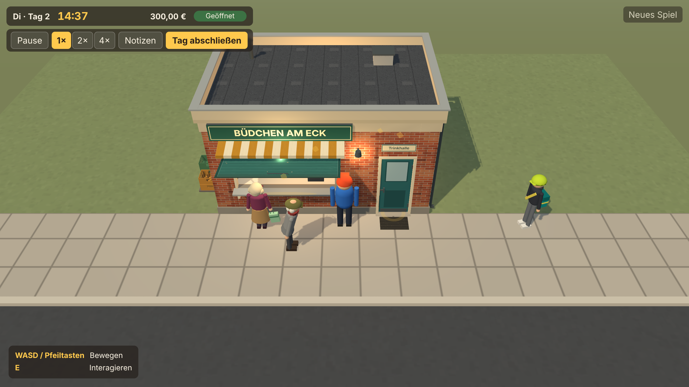
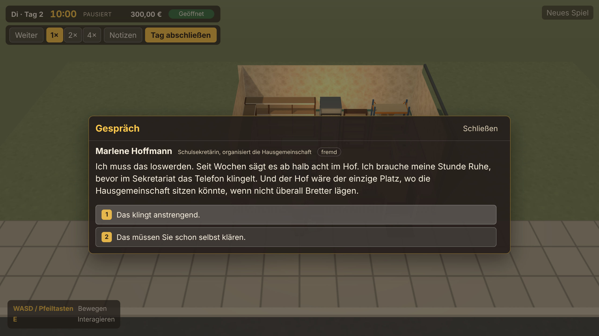
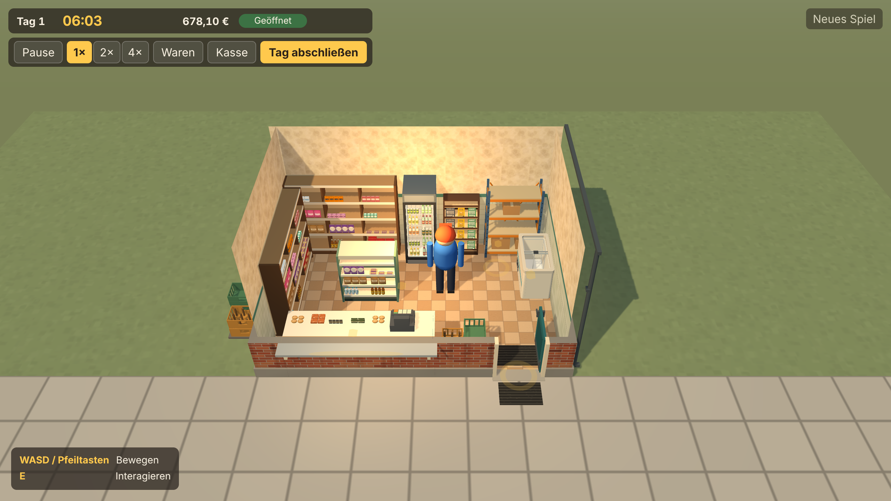
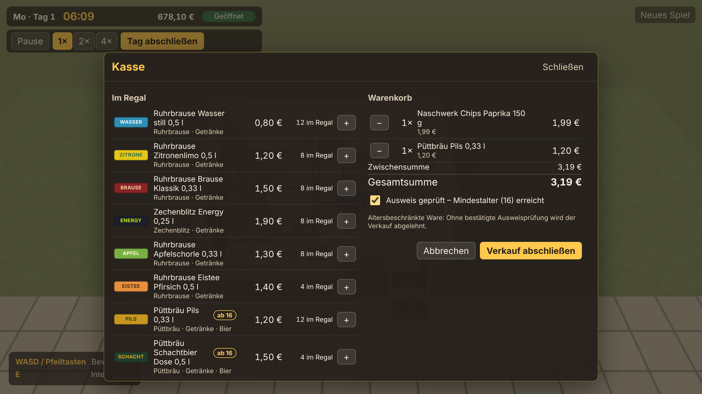
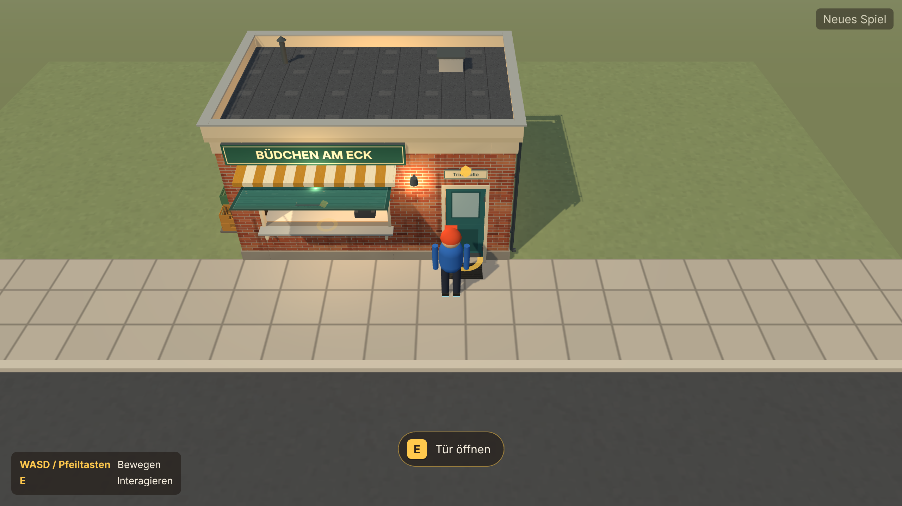
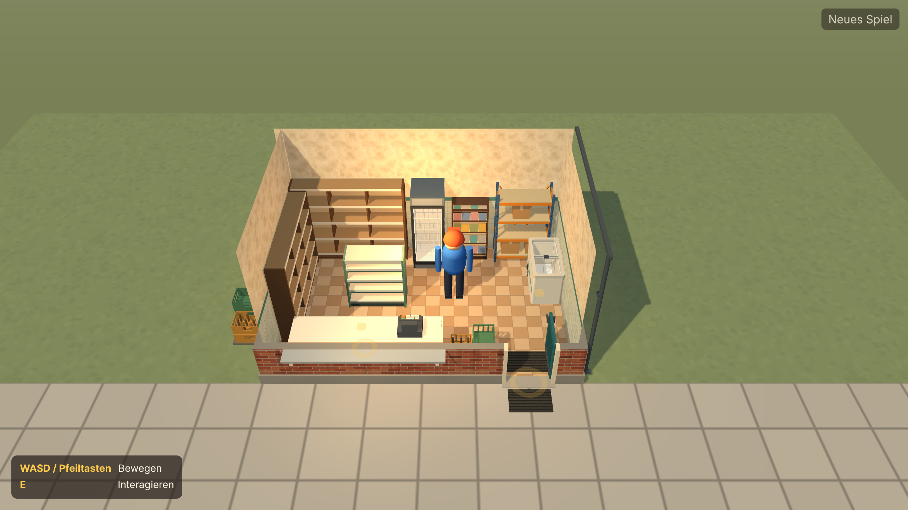

# BuedchenSim
Ein Büdchen-Simulator

## Start für Claude Code
Das [Architektur-Zielbild](docs/ARCHITEKTUR-ZIELBILD.md) beschreibt die langfristige modulare Struktur. Es wird früh geplant, aber schrittweise umgesetzt.
Die verbindlichen Arbeitsanweisungen stehen in [CLAUDE.md](CLAUDE.md). Der chronologische [Implementierungsplan](docs/IMPLEMENTIERUNGSPLAN.md) legt die Reihenfolge der Three.js-Entwicklung fest. Claude Code muss zuerst diese Dateien lesen und anschließend die jeweilige Fachdokumentation.

## Installation und Start
Voraussetzung: Node.js ab 22.12 (geprüft mit 22.23.4) und npm.

```bash
npm install
```

```bash
npm run dev
```

Danach die angezeigte Adresse im Desktop-Browser öffnen. Steuerung: **WASD** oder Pfeiltasten zum Laufen, **E** zum Interagieren (oder Klick auf den Hinweis). Mit **E** an der Kasse (hinter der Theke neben der Kasse) öffnet sich die Kasse, mit **E** am Lagerregal im Kiosk die Warenverwaltung. Kasse und Warenverwaltung sind ortsgebunden; die Leiste oben hat dafür keine Schaltflächen. Sie zeigt den Tag mit Wochentag (z. B. „Mo · Tag 1“). **Escape** schließt die Oberflächen. Bewohner im Viertel sprichst du mit **E** an (Hinweis „Mit … sprechen“, auch per Klick), im Gespräch wählst du Antworten mit der Maus oder den Tasten **1** bis **4**. Mit **J** oder der Schaltfläche „Notizen“ in der Leiste öffnest du das Journal (bekannte Leute und laufende Geschichten). Solange ein Fenster offen ist, steht die Figur still, die Uhr läuft weiter.

| Befehl | Zweck |
|---|---|
| `npm run dev` | Entwicklungsserver |
| `npm run build` | Typprüfung und statischer Build nach `dist/` |
| `npm run preview` | gebauten Stand ausliefern |
| `npm run typecheck` | TypeScript-Prüfung |
| `npm run lint` | ESLint inklusive Schichtenregel |
| `npm run test` | Unit-Tests (Vitest) |
| `npm run check:browser` | Prüfung der laufenden Szene in Chromium mit Screenshots (mehrere Minuten); benötigt einmalig `npx playwright install chromium` |

## Projektstand
Phase 4 ist umgesetzt ([Auftrag 04](docs/auftraege/04-bewohner-und-soziale-bindung.md)): Das Viertel hat **vier wiederkehrende Bewohner**. Vor Phase 5 hat [Auftrag 04.5](docs/auftraege/04-5-visual-identity-und-graphics-foundation.md) die visuelle Basis festgelegt: wärmeres, plastischeres Licht mit Tone Mapping, schlankere Waren- und Figurenmodelle, einen ersten Figuren-Prototyp (Günter als GLB aus einem Blender-Skript, Abnahme offen) und eine verbindliche Style-Spezifikation ([VISUAL-BASELINE.md](docs/VISUAL-BASELINE.md), Vorher/Nachher-Bilder unter [docs/screenshots/auftrag-04-5/](docs/screenshots/auftrag-04-5/README.md)). Phase 3 ([Auftrag 03](docs/auftraege/03-waren-wirtschaftskreislauf-und-spieltag.md)) lieferte darunter den Wirtschaftskreislauf.

**Bewohner und soziale Bindung (Auftrag 04):**
- **Vier Bewohner** mit eigenen Profilen und Figuren (Günter Wollny, Derya Aksoy, Jonas Pietrek, Marlene Hoffmann; alle Namen frei erfunden): Sie kommen nach Tagesroutinen (Tageszeit und Wochentag) über Gehweg, Ecke und Hof zum Kiosk, warten, gehen wieder und laufen weder durch Wände noch durch den Spieler. Routinen und Wünsche sind aus einem gespeicherten Weltseed abgeleitet; ein Neuladen ändert keine Entscheidung.
- **Gespräche** (E): bedingungsabhängige Dialoge, Beziehung (fremd, bekannt, vertraut, eng verbunden) und Erinnerungen, die später Folgen haben.
- **Zwei Alltagsgeschichten** mit mehreren Ausgängen: „Krach im Hinterhof“ (vier Ausgänge; Folgen sind u. a. eine Hofbank und Deryas Sägezeiten) und „Ein Paket für Günter“ (ein Kioskfoto als Dank, je nach Hofentscheidung anders kommentiert).
- **Bewohner als Kunden:** Sie äußern Warenwünsche und kaufen über dieselbe Verkaufsdomäne wie die Kasse (genau eine Buchung je Wunsch). Die Altersprüfung gilt auch für sie; Jonas (17) kann Tabak nie kaufen.
- Der Spielstand (Version 3) enthält zusätzlich Weltseed, Bewohner und Geschichten; Spielstände der Versionen 1 und 2 werden migriert.

Inhalte und Regeln im Detail: [Bewohner, Dialoge und Geschichten](docs/BEWOHNER-UND-GESCHICHTEN.md).

**Wirtschaft und Spieltag (Auftrag 03).** Aufbauend auf dem ausgearbeiteten Kiosk aus Phase 2 ([Auftrag 02](docs/auftraege/02-modularer-kiosk-und-einrichtung.md)) kann der Spieler einen vollständigen Tag führen:

- **Bestellen** bei einem fiktiven Großhandel (28 erfundene Produkte, Startkapital 300,00 €) und die **Lieferung annehmen**; die Ware liegt zunächst im Lager.
- **Einräumen** in Regale, Kühlschrank, Eistruhe, Theke und Zeitschriftenständer; die Ware erscheint sichtbar im 3D-Regal, leere Plätze bleiben leer.
- **Verkaufen** über die Kasse mit Warenkorb. Die Verkaufsklappe muss geöffnet sein. Bei Bier (ab 16) und Tabakwaren (ab 18) ist eine bestätigte Ausweisprüfung eine echte Verkaufsschranke; ohne sie lehnt das Spiel den Verkauf ab.
- **Spielzeit**: 1 Spielminute = 1 Sekunde, Tag von 06:00 bis 22:00 Uhr, Pause und 1×/2×/4×. Um 22:00 Uhr wartet die Uhr auf den ausdrücklichen **Tagesabschluss** (auch vorher möglich) mit Abrechnung; danach beginnt der nächste Tag.
- Der Spielstand (seit Auftrag 03 Version 2) enthält Zeit, Kasse, Bestände und Tagesabrechnung; Spielstände aus Phase 2 werden migriert.

Noch nicht vorhanden: Preisänderungen, Nachfrage und Laufkundschaft (Verkäufe sind ein Kassenvorgang des Spielers, außer den Käufen der vier Bewohner), Wetter, Events, Audio. Alle Marken sind frei erfunden; die Namen sind Arbeitstitel und rechtlich nicht geprüft. Das Sortiment steht im [Produktkatalog](docs/PRODUKTKATALOG.md).

**Prüfstand:** Geprüft wurde ausschließlich automatisch: Typecheck, Lint, 605 Unit- und Integrationstests in 37 Dateien (eigener Lauf am 2026-11-14; der Phase-3-Stand mit 370 Tests wurde dabei bestätigt), Build sowie die Browserprüfung in Headless-Chromium mit Software-Rendering: 149 von 149 Prüfungen bestanden (zwei Läufe nacheinander am 2026-11-14, 1.287 s und 1.188 s). Die Prüfung auf echter Grafikhardware und in Firefox oder Safari steht aus; die Schritte dafür stehen in der [manuellen Prüfanleitung](docs/PRUEFANLEITUNG-MANUELL.md) (Schritte 32 bis 47 für die Bewohner); sie wurden nicht von Hand ausgeführt.

Screenshots der Bewohner und Gespräche (Auftrag 04): neun Bilder unter [`docs/screenshots/auftrag-04/`](docs/screenshots/auftrag-04/README.md), jedes mit Beschreibung in der dortigen README:









Weitere Screenshots aus der laufenden Anwendung: [Warenverwaltung](docs/screenshots/auftrag-03-warenverwaltung.png), [Tagesabrechnung](docs/screenshots/auftrag-03-tagesabschluss.png).





- [Technischer Ist-Stand](docs/TECHNISCHER-IST-STAND.md) – was tatsächlich implementiert und geprüft ist
- [ThreeRT – Proof of Concept](docs/THREERT-POC.md) – separater Versuch mit einem Pfadverfolger; Ergebnis: nicht als Hauptrenderer, allenfalls als Offline-Werkzeug
- [Architektur-Entscheidungen (ADRs)](docs/ARCHITEKTUR-ENTSCHEIDUNGEN.md)
- [Modul- und Datenverträge](docs/MODUL-UND-DATENVERTRAEGE.md)
- [Produktkatalog](docs/PRODUKTKATALOG.md) – alle 28 Produkte mit Preisen, Alterskennzeichen, Asset-IDs und Warenplätzen
- [Bewohner, Dialoge und Geschichten](docs/BEWOHNER-UND-GESCHICHTEN.md) – Profile, Routinen und Wege, Dialogsystem, beide Geschichten mit allen Ausgängen, Kundenkäufe, Alterskontrolle

## Produktentscheidungen
- **O-1 – Perspektive (entschieden):** Third Person mit schräger, leicht erhöhter Kamera; WASD und E, Maus ergänzend.
- **O-2 – Plattform (entschieden):** Desktop-Browser mit Maus und Tastatur zuerst; Touch später.
- **O-3 – Zeitmodell (entschieden, umgesetzt in Auftrag 03):** 1 Spielminute = 1 Sekunde, Öffnungstag 06:00–22:00 Uhr, pausierbar und vorspulbar, mit Tagesabschluss.
- **O-4 – Alkohol und Tabak (entschieden, umgesetzt in Auftrag 03):** fiktives Bier und fiktive Tabakwaren sind verkaufbar, mit Alterskennzeichen, neutraler, nicht werblicher Darstellung und einer echten Altersprüfung an der Kasse. Seit Auftrag 04 gilt die Altersschranke auch für Bewohner als Kunden (Alter aus den Inhaltsdaten).
- **Offen:** O-5 Hosting und Lizenz.

## Nächster Schritt
Phase 4 – **Bewohner, Kundenverhalten und soziale Bindung** ist mit [Auftrag 04](docs/auftraege/04-bewohner-und-soziale-bindung.md) umgesetzt (Prüfstand siehe oben). Der visuelle Qualitätsschritt [Auftrag 04.5 – Visual Identity & Graphics Foundation](docs/auftraege/04-5-visual-identity-und-graphics-foundation.md) ist umgesetzt ([Abschlussbericht](docs/PHASE-04-5-ABSCHLUSSBERICHT.md)); neue Grafik folgt ab jetzt den Regeln in [VISUAL-BASELINE.md](docs/VISUAL-BASELINE.md). Die vollständige Detailpolitur bleibt später.

Die Spezifikation für Phase 5 ist bereits vorbereitet: [Auftrag 05 – Das lebendige Viertel](docs/auftraege/05-das-lebendige-viertel.md). Sie verbindet Kalender und Jahreszeiten, Wettervorhersage, fünf erste Veranstaltungen, dynamische Nachfrage, NPC-Reaktionen und die Spezialität **Frikadelle im Brötchen**. Die Umsetzung steht ausdrücklich noch aus und setzt die technische Bestandsaufnahme nach Auftrag 04 voraus. Die visuelle Grundlage dafür steht mit Auftrag 04.5.

## Projekt-Dokumentation
Die Art-Direction, Produktionsplanung, Regionen, fiktive Produktwelt, Claude-Code-Prompts und Three.js-Asset-Standards liegen unter [docs/artwork-prompts](docs/artwork-prompts/README.md).

**Wichtige Gestaltungsregel:** ausschließlich fiktive Marken, Logos, Verpackungen und Beschilderung. Keine realen Marken oder nachgebildeten geschützten Designs.
