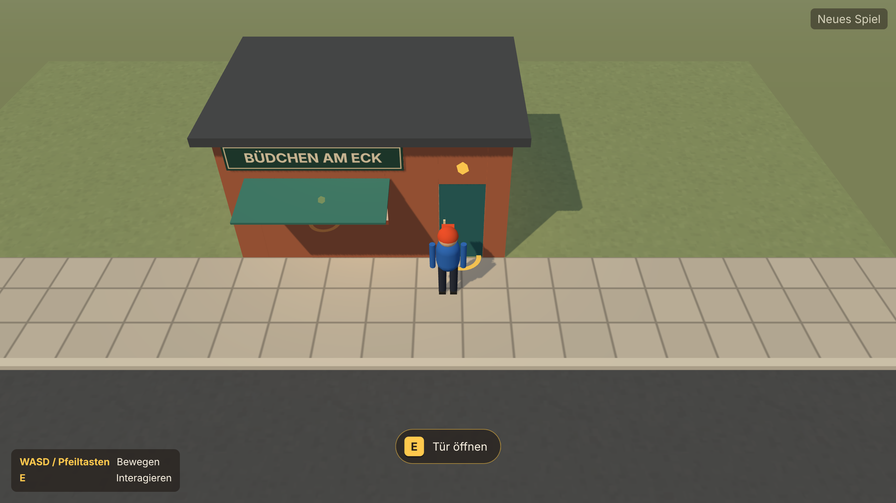

# BuedchenSim
Ein Büdchen-Simulator

## Start für Claude Code
Das [Architektur-Zielbild](docs/ARCHITEKTUR-ZIELBILD.md) beschreibt die langfristige modulare Struktur. Es wird früh geplant, aber schrittweise umgesetzt.
Die verbindlichen Arbeitsanweisungen stehen in [CLAUDE.md](CLAUDE.md). Der chronologische [Implementierungsplan](docs/IMPLEMENTIERUNGSPLAN.md) legt die Reihenfolge der Three.js-Entwicklung fest. Claude Code muss zuerst diese Dateien lesen und anschließend die jeweilige Fachdokumentation.

## Installation und Start
Voraussetzung: Node.js ab 22.12 (geprüft mit 22.23.4) und npm.

```bash
npm install
```

```bash
npm run dev
```

Danach die angezeigte Adresse im Desktop-Browser öffnen. Steuerung: **WASD** oder Pfeiltasten zum Laufen, **E** zum Interagieren (oder Klick auf den Hinweis).

| Befehl | Zweck |
|---|---|
| `npm run dev` | Entwicklungsserver |
| `npm run build` | Typprüfung und statischer Build nach `dist/` |
| `npm run preview` | gebauten Stand ausliefern |
| `npm run typecheck` | TypeScript-Prüfung |
| `npm run lint` | ESLint inklusive Schichtenregel |
| `npm run test` | Unit-Tests (Vitest) |
| `npm run check:browser` | Prüfung der laufenden Szene in Chromium mit Screenshots; benötigt einmalig `npx playwright install chromium` |

## Projektstand
Phase 1 ist abgeschlossen ([Auftrag 01](docs/auftraege/01-threejs-projektgeruest-und-greybox.md)): eine begehbare Kiosk-Greybox mit Third-Person-Kamera, Kollision, zwei Interaktionen (Tür, Verkaufsklappe) und automatischem Speichern. Wirtschaft, Produkte, Bewohner und Ereignisse folgen in den nächsten Phasen.



- [Technischer Ist-Stand](docs/TECHNISCHER-IST-STAND.md) – was tatsächlich implementiert und geprüft ist
- [Architektur-Entscheidungen (ADRs)](docs/ARCHITEKTUR-ENTSCHEIDUNGEN.md)
- [Modul- und Datenverträge](docs/MODUL-UND-DATENVERTRAEGE.md)

## Produktentscheidungen
- **O-1 – Perspektive (entschieden):** Third Person mit schräger, leicht erhöhter Kamera; WASD und E, Maus ergänzend.
- **O-2 – Plattform (entschieden):** Desktop-Browser mit Maus und Tastatur zuerst; Touch später.
- **Offen:** O-3 Zeitmodell, O-4 Alkohol und Tabak, O-5 Hosting und Lizenz.

## Nächster Schritt
[Auftrag 02 – Modularer Kiosk und Einrichtung](docs/auftraege/02-modularer-kiosk-und-einrichtung.md): Fassade und Einrichtung als wiederverwendbare Assets mit verschiebbarer Platzierungsliste ausarbeiten. Der Auftrag enthält außerdem die gezielte Prüfung der zehn npm-Audit-Hinweise und die Nacharbeit an Sichtfreistellung und Klappenmarkierung.

## Projekt-Dokumentation
Die Art-Direction, Produktionsplanung, Regionen, fiktive Produktwelt, Claude-Code-Prompts und Three.js-Asset-Standards liegen unter [docs/artwork-prompts](docs/artwork-prompts/README.md).

**Wichtige Gestaltungsregel:** ausschließlich fiktive Marken, Logos, Verpackungen und Beschilderung. Keine realen Marken oder nachgebildeten geschützten Designs.
