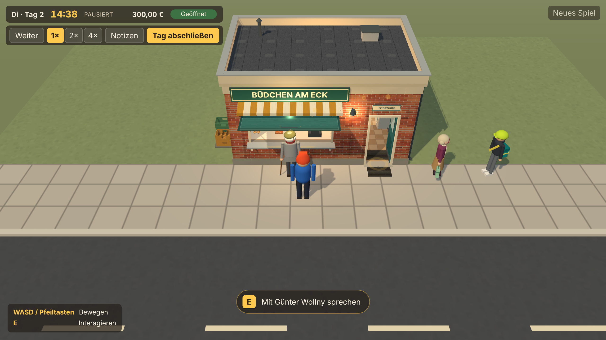
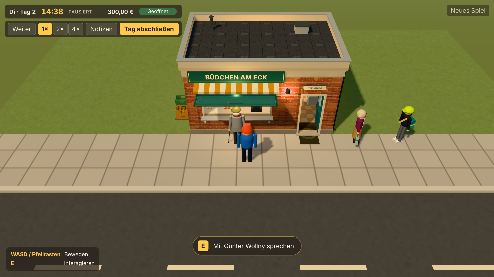
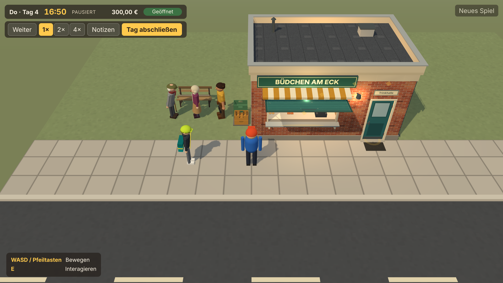
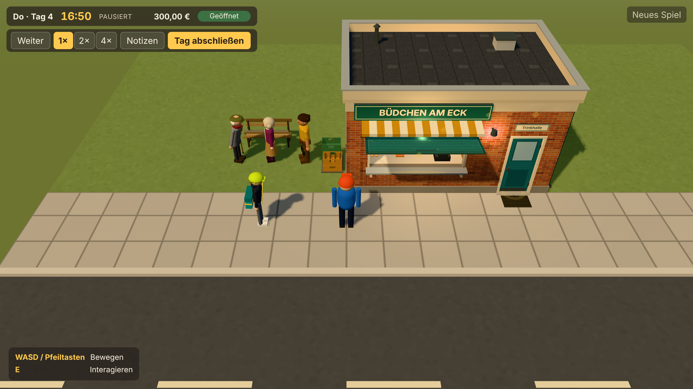

# Abschlussbericht Auftrag 04.5 – Visual Identity & Graphics Foundation

**Datum:** 2026-11-14 · **Branch:** `claude/elegant-curie-17qulu` · Auftrag: [04.5](auftraege/04-5-visual-identity-und-graphics-foundation.md) · Details und Style-Regeln: [VISUAL-BASELINE.md](VISUAL-BASELINE.md)

Alle Prüfungen liefen in Node (Vitest) und in Headless-Chromium mit Software-Rendering (SwiftShader). **Echte Grafikhardware stand nicht zur Verfügung; Bildrate und GPU-Last auf echter Hardware sind offen.**

## 1. Ausgangslage und Zielbild
Die Szene war funktional, aber flach: starkes Halbkugel- und Umgebungslicht, schwache Sonne, kein Tone Mapping. Volle Regale kosteten 440.088 Dreiecke; Ursache waren zu fein unterteilte Warenmodelle (bis 780 Dreiecke je Brötchen). Drei Bewohner kosteten rund 180 Draw Calls. Zielbild (verbindlich, [VISUAL-BASELINE.md, Abschnitt 4](VISUAL-BASELINE.md)): ein warmes, leicht stilisiertes Diorama mit gerichtetem Sonnenlicht, gedämpfter Umgebung, charaktervollem Kiosk und Waren als Farbblock mit Emblem; Detaildichte nach Bildschirmgröße aus der Spielkamera.

## 2. Konkrete visuelle Änderungen
1. **Tone Mapping:** Khronos PBR Neutral bei Belichtung 1,0. Es erhält die Farbtöne und rollt Lichtspitzen ab (vorher kein Tone Mapping).
2. **Licht:** Halbkugellicht 1,15 → 0,85, Umgebungslicht 0,15 → 0,06, Sonne 2,5 → 3,3 in wärmerem Ton, Schattenradius 2,5; Innenlampe 14 → 11 (überstrahlte unter Tone Mapping). Alle Werte gebündelt in `LIGHT`.
3. **Palette:** Wiese und Grundfläche etwas frischer, Asphalt heller (unter Tone Mapping zu dunkel und bräunlich).
4. **Waren:** Flaschen und Dosen 8 statt 14 Segmente; Tüten und Stieleis 4 × 6 statt 8 × 14 × 2 Unterteilungen; Backwaren und Eisbecher gröber. Brötchen 780 → 164 Dreiecke, Tüte 624 → 136, PET-Flasche 476 → 272, Glasflasche 448 → 256, Dose 396 → 240. Maße und Etiketten unverändert.
5. **Bewohner:** Statische Teile werden je Gelenkgruppe und Material zu einem Mesh zusammengeführt; Animation, Silhouette und Farben unverändert.
6. **Signalfarben:** Interaktionsmarkierungen und die Röntgen-Silhouette der Spielfigur sind vom Tone Mapping ausgenommen. Sonst verschiebt sich das reservierte Interaktionsgelb, und die Silhouette verliert ihre Signalfarbe (die Browserprüfung erkannte sie nicht mehr).
7. **Messwerkzeug:** `scripts/visual-shots.mjs` erzeugt fünf Referenzansichten mit festem Spielstand und Messwerten.

## 3. Betroffene Dateien und Asset-IDs
- `src/world/renderer.ts` (Tone Mapping), `src/world/world.ts` (Licht `LIGHT`), `src/world/materials.ts` (Palette, Markierung), `src/world/assets/kiosk/lighting.ts` (Innenlampe), `src/world/playerFigure.ts` (Silhouette).
- `src/world/assets/products/bottles.ts`, `kit.ts`, `food.ts` – Asset-IDs P-001 bis P-028 (Geometrie, Status unverändert).
- `src/world/assets/residents/kit.ts` (`mergeStaticParts`), Test `residents.test.ts` – Asset-IDs N-002, N-003, N-006, N-007.
- `scripts/visual-shots.mjs` (neu), `scripts/browser-check.mjs` (Lint-Korrektur).
- Dokumente: `docs/VISUAL-BASELINE.md`, `docs/screenshots/auftrag-04-5/` (neu), Ist-Stand, Implementierungsplan, README, Asset-Register.
- Unverändert: Asset-IDs, Platzierungsverträge, Interaktionspunkte, Kollisionen, Warenbestände, Savegame Version 3.

## 4. Renderer- und Materialentscheidungen
- **Neutral statt ACES/AgX:** Neutral verändert Farbtöne am wenigsten. Die fiktiven Marken leben von ihren Farben, ACES hätte sie verschoben. Belichtung bleibt 1,0, abgestimmt mit dem Licht.
- **Lambert bleibt:** Eine pauschale Umstellung auf PBR-Materialien hätte Waren und Figuren ungewollt verändert und mehr Rechenzeit gekostet. PBR nur gezielt, mit Vorher/Nachher-Vergleich.
- **Keine Schatten für Waren:** zu klein für sichtbaren Nutzen und zu teuer.
- **Geometrie statt Instancing bei Figuren:** Vier Figuren sind zu wenige für Instancing. Das Zusammenführen pro Gelenkgruppe senkt die Draw Calls, ohne die Animation anzufassen. Dafür besitzt jede Figur ihre Geometrien selbst; die Zahl der Geometrien steigt leicht.

## 5. Vorher-/Nachher-Screenshots
Unter [`docs/screenshots/auftrag-04-5/`](screenshots/auftrag-04-5/README.md): `vorher/` und `nachher/` mit identischen Spielzuständen und Kamerapositionen für Außenansicht, Innenraum, bestückte Regale, Bewohner im Viertel und eine Detailansicht der Materialien.

| Vorher | Nachher |
|---|---|
|  |  |
|  |  |

## 6. Performancewerte und Messbedingungen
Headless Chromium 153, SwiftShader, 1280 × 720, Gerätefaktor 1, Spiel angehalten, Messdauer 4 s je Ansicht, Werte aus `renderer.info` (Draw Calls einschließlich Schattenpass).

| Ansicht | Draw Calls vorher → nachher | Dreiecke vorher → nachher |
|---|---|---|
| Außenansicht, 3 Bewohner, 203 Waren | 485 → 407 | 106.008 → 74.268 |
| Innenraum, 1.573 Waren | 272 → 272 | 440.088 → 187.748 |
| Bewohner, 4 Bewohner, 203 Waren | 559 → 461 | 110.124 → 78.384 |
| Detail ohne Bewohner | 303 → 303 | 93.116 → 61.376 |

Die Bildzeit liegt im Software-Rendering bei 240–560 ms (Median), mit 8–20 Bildern je Messung und großer Streuung. Eine Verbesserung oder Verschlechterung der Bildrate lässt sich daraus nicht belegen. Belegt ist der geringere Aufwand: weniger Dreiecke und Draw Calls. Eine Messung auf echter Hardware (Gerät, Browser, Auflösung, Messdauer) ist offen; die Schritte stehen in [PRUEFANLEITUNG-MANUELL.md](PRUEFANLEITUNG-MANUELL.md).

## 7. Tatsächlich ausgeführte Tests
| Befehl | Ergebnis |
|---|---|
| `npm run typecheck` | fehlerfrei |
| `npm run lint` | fehlerfrei |
| `npm run test` | 37 Dateien, 605 Tests bestanden |
| `npm run build` | erfolgreich (Spielcode 287 kB, Three.js 548 kB) |
| `npm run check:browser` | [[BROWSERCHECK]] |

Die Browserprüfung umfasst die geforderten Nachweise: Warenbestände und Regalplätze, Interaktionspunkte, Tür, Klappe und Kollisionen, Bewohner (Erscheinen, Bewegung, Ansprechbarkeit), Dialoge und Kundenkäufe, Sichtfreistellung, Savegame Version 3 mit Migrationen. Die visuellen Referenzansichten wurden vorher und nachher erzeugt und von mir angesehen.

## 8. Offene Einschränkungen
- Keine Prüfung auf echter Grafikhardware; Bildrate und GPU-Last offen.
- Schrift auf Flaschen und Dosen bleibt aus der Spielkamera unlesbar (4–6 px breit); Unterscheidung über Farbe und Deckel.
- Eine Hervorhebung ausgewählter Waren gibt es noch nicht.
- Horizont: Wiese läuft im Nebel gegen einen einfarbigen Hintergrund (Umgebung ist Phase 6).
- Materialien bleiben matt (Lambert); Glanz von Metall und Glas nur angedeutet.
- Die Bewohner-Draw-Calls bleiben spürbar (rund 35–40 je sichtbarer Figur einschließlich Schattenpass, vorher rund 60).

## 9. Branch und Commits
Branch `claude/elegant-curie-17qulu`; Commit-Hashes: [[COMMITS]].
