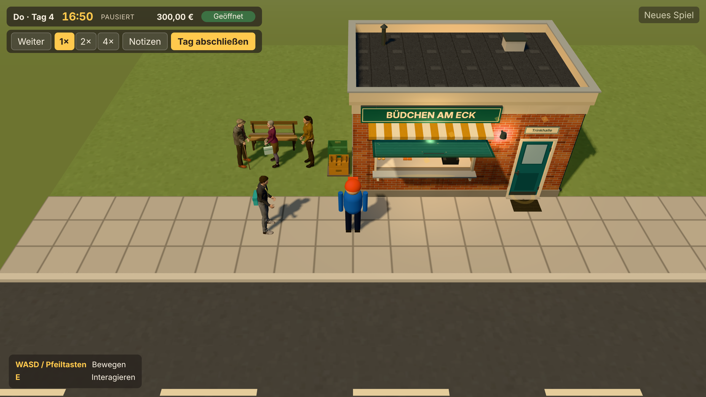
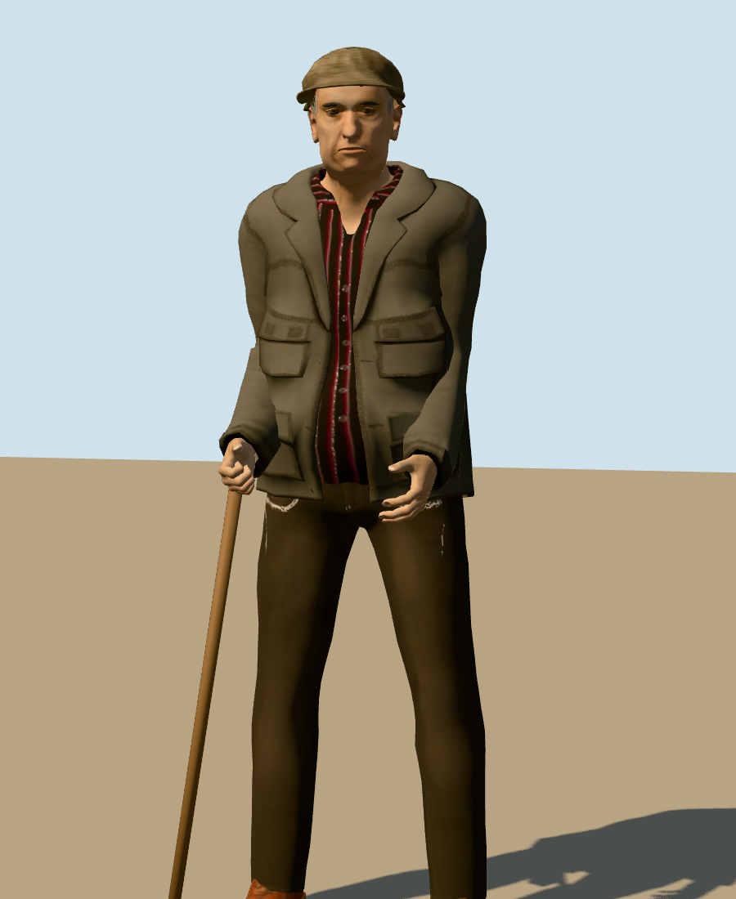
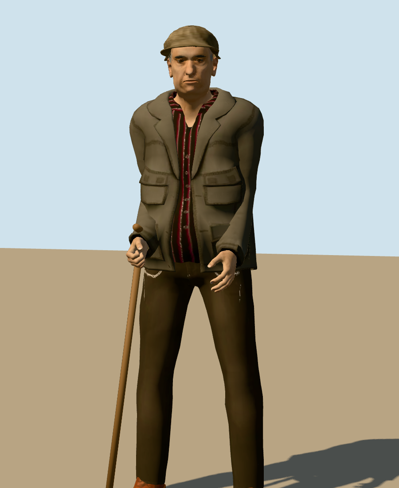

# Abschlussbericht Auftrag 04.6 – Bewohnerfiguren und Charakterpipeline

**Datum:** 2026-11-14 · **Branch:** `claude/elegant-curie-17qulu` · Auftrag: [04.6](auftraege/04-6-bewohnerfiguren-und-charakterpipeline.md) · Bestandsaufnahme: [PHASE-04-6-BESTANDSAUFNAHME.md](PHASE-04-6-BESTANDSAUFNAHME.md) · Details: [VISUAL-BASELINE.md, Abschnitt 8.6](VISUAL-BASELINE.md)

Alle Prüfungen liefen in Node (Vitest) und in Headless-Chromium mit Software-Rendering (SwiftShader). **Echte Grafikhardware stand nicht zur Verfügung; Bildrate und GPU-Last auf echter Hardware sind offen.**

## 1. Ausgangslage und tatsächliche Pipeline
Nach Auftrag 04.5 war nur Günter (N-002) eine GLB-Figur; Derya, Jonas und Marlene waren prozedurale Blockfiguren. Pipeline (unverändert im Grundsatz, siehe ADR-023): CC0-MakeHuman-Daten → Blender 5.3 als Python-Modul → GLB → `RESIDENT_MODELS` → `residentView` (GLTFLoader, Skelettkopie, AnimationMixer, prozeduraler Rückfall). Neu: Die Daten lassen sich mit `tools/characters/fetch_mh_data.sh` reproduzierbar laden (SHA-256-geprüft); das Skript `tools/characters/build_mh_resident.py` baut jede Figur aus einer Spezifikation (`--resident guenter|derya|jonas|marlene`). Keine parallele Pipeline, keine Vertragsänderung außer der optionalen Mimik.

## 2. Änderungen an Günter
Erscheinung, Gesicht, Kleidung, Farben, Mütze und Silhouette bleiben. Gezielt korrigiert:
- **Arme und Hände:** Arme näher am Körper, rechte Hand umgreift den Stock (Stock mit gebogenem Griff), linke Hand hängt neben dem Oberschenkel statt davor.
- **Rote Punkte neben der Nase:** waren die stark roten Innenflächen der Nasenlöcher in der Hauttextur; sie werden zu einem Hautschatten abgedunkelt, nur in den beiden Texturbereichen der Nasen- und Mundinnenflächen (die Lippen bleiben).
- **Schirmkanten:** 64 statt 40 Segmente, der Schirm läuft an den Enden mit einer weichen Kurve aus, statt in Stufen zu enden.
- **Mimik:** siehe Abschnitt 5.

Vorher/Nachher: `docs/screenshots/auftrag-04-6/guenter-vorher-*.png` und `guenter-nachher-*.png`.

## 3. Individuelle Gestaltung der drei weiteren Figuren
Abgeleitet aus `src/content/regions/ruhrgebiet/residents.ts` (Alter, Rolle, Beschreibung) und der in Auftrag 04 eingeführten Erscheinung; keine neuen Persönlichkeitsmerkmale.

| Figur | Körper und Gesicht | Kleidung, Frisur, Requisiten | Haltung, Gesten |
|---|---|---|---|
| **Derya (N-003)**, 38, Tischlerin | weiblich, kräftig, breitere Schultern, 1,78 m; markante Wangenknochen, kräftigeres Kinn, Nase mit leichtem Höcker | senfgelbes Arbeitshemd, braune Arbeitshose, braune Stiefel, dunkler Zopf, Werkzeuggürtel mit Tasche rechts und Hammer links | aufrecht, fester Stand, zügiger Gang, Geste mit der rechten Hand |
| **Jonas (N-006)**, 17, Fahrradkurier | männlich, MakeHuman-Alter für etwa 17 Jahre (jugendliche Proportionen aus den Altersformen, keine Skalierung eines Erwachsenen), schlank, 1,82 m; schmaleres Gesicht | limettengrüner Fahrradhelm, dunkelgraue Jacke, hellgraue Hose, weiße Turnschuhe, petrolfarbene Kuriertasche hinten mit gelbem Gurt über die Brust | leicht vorgebeugt, lange schnelle Schritte, Gesten mit beiden Händen |
| **Marlene (N-007)**, 58, Schulsekretärin | weiblich, etwas fülliger, 1,61 m; runderes Gesicht, vollere Wangen | pflaumenfarbenes Strickoberteil, kamelfarbener Rock, dunkle Strumpfhose, Halbschuhe, silberblondes Kurzhaar, rote Brille, mintgrüne Einkaufstasche links | aufrecht, linke Hand trägt die Tasche, Geste mit der rechten Hand |

Alle drei unterscheiden sich schon in Silhouette und Farbe (Spielkamera: `docs/screenshots/auftrag-04-6/*-spielkamera.png`, `spiel/bewohner.png`). Die Kleidung stammt aus dem CC0-Asset-Pack und wurde im Skript umgefärbt; Kleidung mit Projektlogo wird nicht verwendet, Lizenzhinweise in Texturen werden entfernt. Die Altersprüfung im Spiel ist unverändert (Inhaltsdaten).

## 4. Asset-IDs, Dateigrößen und Budgets
| Asset-ID | Datei | Dreiecke | Primitive | Texturen | Größe | `walkSpeed` |
|---|---|---|---|---|---|---|
| N-002 | `public/models/residents/n-002.glb` | 30.234 | 9 | 8 WebP, 267 kB | 1,52 MB | 0,9 |
| N-003 | `n-003.glb` | 31.607 | 11 | 7 WebP, 157 kB | 1,50 MB | 1,1 |
| N-006 | `n-006.glb` | 31.593 | 12 | 7 WebP, 134 kB | 1,43 MB | 1,3 |
| N-007 | `n-007.glb` | 31.552 | 11 | 7 WebP, 198 kB | 1,54 MB | 0,8 |

Budget je Figur (≤ 32.000 Dreiecke, ≤ 12 Primitive, ≤ 2 MB, Texturen ≤ 1024²) eingehalten. Dafür sind Kleidung, Haare und Schuhe von Derya, Jonas und Marlene mit Decimate auf 55–80 % reduziert. `walkSpeed` ist die Schrittlänge je Sekunde des Gehclips; das Abspieltempo folgt der Geschwindigkeit aus den Inhaltsdaten.

## 5. Mimik: Entscheidung und Grenzen
**Umgesetzt** als kleiner, stabiler Umfang mit derselben Lösung für alle vier Figuren: drei Morph Targets (`friendly`, `thoughtful`, `blink`) aus MakeHuman-Ausdruckseinheiten, an Körper, Brauen und Wimpern. Blender exportiert sie dünn besetzt und ohne Normalen, das kostet rund 90 kB je Datei. Zur Laufzeit (`glbResident.ts`): Blinzeln alle 2,5–6 s (deterministisch je Figur), beim Sprechen weicher Wechsel freundlich → nachdenklich → freundlich, sonst neutral; keine Daueranimation. Test: `glbResident.test.ts`. **Grenzen:** Ausdrücke folgen der Zeit, nicht dem Inhalt der Dialogzeile; keine Lippensynchronisation; aus der Spielkamera sind Ausdrücke nicht erkennbar (nur in Nahansicht), im Gespräch verdeckt das Dialogfenster die Figur.

## 6. Performancewerte und Messbedingungen
Headless Chromium, SwiftShader, 1280 × 720, Gerätefaktor 1, Spiel angehalten, 4 s je Ansicht (`scripts/visual-shots.mjs`, `docs/screenshots/auftrag-04-6/spiel/metrics.json`).

| Ansicht | Draw Calls | Dreiecke |
|---|---|---|
| `bewohner`, vier Figuren | 399 (nach 04.5 mit prozeduralen Figuren 461) | 311.756 (78.384) |
| `aussen`, drei Figuren | 367 (407) | 248.134 (74.268) |

Die Dreiecke steigen deutlich (jede Figur etwa 31.000, dazu der Schattenpass), die Draw Calls sinken. Speicher (geschätzt): je Datei rund 1 MB Geometrie und 11–13 MB entpackte Texturen mit Mipmaps; je Instanz zusätzlich nur das Skelett (53 Knochen). Ladezeit vom lokalen Entwicklungsserver 22–30 ms je Datei, zusammen rund 6 MB; über ein Netz entscheidet die Bandbreite. Bis zum Laden stehen die prozeduralen Figuren. Bildzeiten im Software-Rendering sind nicht aussagekräftig; keine FPS-Aussage.

**Robustheit (ausgeführt):** `visual-shots.mjs --block n-003.glb` → Derya bleibt prozedural, die anderen drei laden, Warnung im Log; `--corrupt n-007.glb` (kaputte Bytes) → Marlene bleibt prozedural, Warnung im Log. Mehrere gleichzeitig animierte Figuren: Szene `bewohner` mit vier Figuren, jede mit eigenem Mixer und Skelett.

## 7. Screenshots
Unter [`docs/screenshots/auftrag-04-6/`](screenshots/auftrag-04-6/README.md): je Figur Nahansicht, Ganzkörper, Gehen, Sprechen (mit Ausdruck) und Spielkamera; alle vier gemeinsam im Spiel; Gesprächssituation im Spiel; Günter vorher/nachher; Günters Ausdrücke.

| Alle vier im Spiel | Günter vorher → nachher |
|---|---|
|  |   |

## 8. Tatsächlich ausgeführte Tests
| Befehl | Ergebnis |
|---|---|
| `npm run typecheck` | fehlerfrei |
| `npm run lint` | fehlerfrei |
| `npm run test` | 38 Dateien, 609 Tests bestanden (neu: Mimik und Blinzeln in `glbResident.test.ts`) |
| `npm run build` | erfolgreich |
| `npm run check:browser` | 149 von 149 Prüfungen bestanden (1.418 s, Headless-Chromium mit SwiftShader), ausgeführt nach der letzten Code- und Modelländerung mit allen vier GLB-Figuren |

## 9. Regression und offene Einschränkungen
Die Browserprüfung deckt Erscheinen und Tagesroutinen der Bewohner, Navigation und Ausweichen, Dialoge mit Optionen, Beziehungen, Erinnerungen und beide Geschichten, NPC-Käufe über die Verkaufsdomäne, die Altersprüfung (Jonas kauft keinen Tabak), Interaktionen, Kollisionen, Tür und Klappe sowie Savegame Version 3 mit Migrationen ab. Spielsimulation, Dialoge, Beziehungen, Wirtschaft und Savegame wurden nicht geändert; geändert sind nur die Darstellung (`glbResident.ts`, `residentView.ts` mit der neuen Debug-Angabe `model`) und Werkzeuge.

**Manuell gesichtet (Screenshots):** alle Bilder in Abschnitt 7. **Nicht geprüft:** echte Grafikhardware, Firefox und Safari, Laden über ein langsames Netz.

**Offene Einschränkungen:**
- Requisiten aus dem Skript (Mütze, Helm, Taschen, Gürtel, Brille) sind schlichter als die MakeHuman-Teile; Jonas' Helm hat keine Lüftungsschlitze.
- Hände greifen Stock und Einkaufstasche nur angedeutet; die Tasche schwingt beim Gehen starr mit der Hand.
- Bei Derya ragt ein kleines Gürtelende der Hose an der Hüfte durch das Hemd.
- Mimik zeitgesteuert, nicht inhaltsbezogen; in der Spielkamera nicht sichtbar.
- Die Figuren sind deutlich detaillierter als Gebäude und Waren (gewollt laut Art Direction); PBR-Materialien der Figuren und Lambert-Welt sind nicht angeglichen.
- Rund 6 MB Figurendaten beim Start; bei langsamer Verbindung stehen anfangs die prozeduralen Figuren.

## 10. Branch und Commits
Branch `claude/elegant-curie-17qulu`; Commits (älteste zuerst): `c2fe775` (Bestandsaufnahme, Download-Skript), `bbdca0d` (Skript auf Spezifikationen, Günter-Korrekturen, Mimik), `99c6f32` (Derya, Jonas, Marlene), `61919e5` (Referenzbilder, Gesprächsansicht, Rückfallprüfung), `2121dd7` (Dokumentation) sowie dieser Abschluss-Commit.
