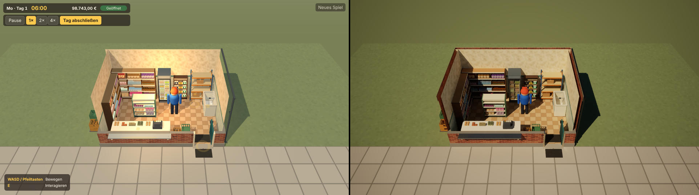
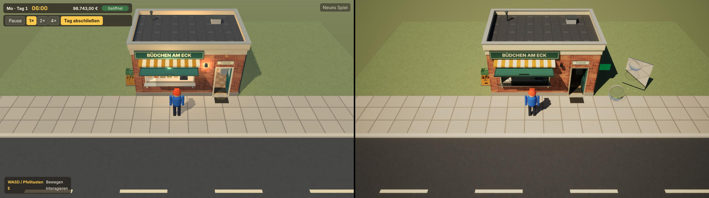
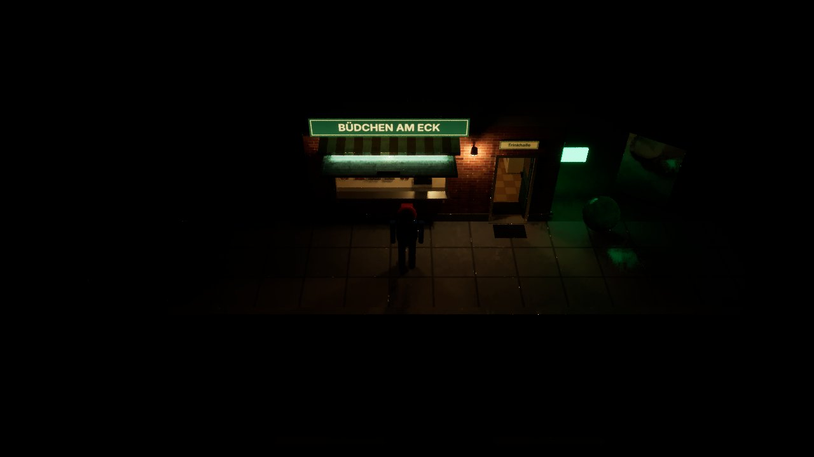

# ThreeRT – Proof of Concept und Integrationsbewertung

**Stand:** 2026-11-13 · geprüft: ThreeRT `main` @ `8964dc4` (Version 0.1.1, MIT-Lizenz) · Code des Versuchs: [`experiments/threert-poc/`](../experiments/threert-poc/README.md)

Der Versuch ändert nichts am Spiel. Unter `src/` wurde keine Datei angefasst. Die einzige Änderung außerhalb des Versuchsordners ist ein Eintrag in `eslint.config.js`, der `experiments/**` von der Spielprüfung ausnimmt.

## 1. Kurzfassung

- **Was ThreeRT ist:** kein Zusatz-Renderer für eine bestehende Three.js-Szene. ThreeRT ist eine eigene Engine in Rust auf Basis von wgpu, mit einer eigenen, Three.js-ähnlichen Szenen-API (`@threert/scene`). Hardware-Raytracing gibt es nur nativ (Metal, Vulkan): im eigenen Rust-Renderer oder in den geschlossenen Apps für macOS und iOS. Im Browser läuft ThreeRT als WebAssembly-Modul auf WebGPU ohne Hardware-Raytracing; die Strahlen werden dort in Software verfolgt.
- **Was im Versuch funktioniert hat:**
  - Installation und Build.
  - Übernahme unserer echten, bestückten Kiosk-Szene über GLB.
  - Pfadverfolgtes Licht mit indirekter Beleuchtung, weichen Schatten, Glas, Spiegelung und leuchtenden Flächen als Lichtquellen.
  - Kamerafahrt im Echtzeit-Renderer.
  - Start im Browser (Chromium, WebGPU).
- **Was nicht prüfbar war:** Die Testumgebung hat **keine Grafikkarte**. Hardware-Raytracing, echte Bildraten und GPU-Auslastung ließen sich nicht messen. Alle Zeiten unten stammen aus einem Software-Vulkan (Mesa lavapipe auf 4 CPU-Kernen) bzw. aus Software-WebGPU (SwiftShader). Sie sagen nichts über die Leistung auf einer echten GPU aus.
- **Empfehlung:** Den Hauptrenderer jetzt **nicht** ersetzen und ThreeRT nicht in den Spielablauf integrieren. Sinnvoll und risikoarm ist eine getrennte Nutzung als Offline-Werkzeug für Referenz- und Werbebilder (Abschnitt 10). Vor jeder weiteren Entscheidung steht ein Test auf echter Grafikhardware (Abschnitt 11).

## 2. Was ThreeRT technisch ist

| Teil | Inhalt | Bedeutung für uns |
|---|---|---|
| `@threert/scene` | eigene Klassen mit Three.js-Namen (`Scene`, `Mesh`, `MeshStandardMaterial`, …), Licht in physikalischen Einheiten (Lux, Candela, Nits) | Es sind **nicht** die Three.js-Objekte. Unsere Szene muss übersetzt werden; im Versuch über GLB. |
| `threert-render` (Rust, wgpu) | Pfadverfolger mit Hardware-Raytracing über Ray Queries, wo vorhanden, sonst Software-BVH; Echtzeit-Ansicht mit Rauschfilter; eingebettete JavaScript-Engine (QuickJS) für den Szenencode | Nativ, nicht im Browser. Für den Bau braucht es Rust 1.100. |
| Apps für macOS und iOS | fertige Clients, die ThreeRT-Spiele laden | geschlossener Quellcode; nur Apple-Geräte |
| `renderer/web` | dieselbe Engine als WebAssembly-Modul auf WebGPU | ohne Hardware-Raytracing; laut ThreeRT-Doku bisher nur in Chrome auf einem Apple-Rechner und mit einer Minimalszene gemessen |
| Laufzeitmodell | Spiele als `defineGame` mit Zustand, Handlern und Frame-Skript in ThreeRTs eigener Laufzeit | passt nicht zu unserer Schichtenarchitektur (`core`/`game`/`world`/`ui`); siehe Abschnitt 6 |

Das Projekt ist jung: Es wurde am 2026-11-10 aus einem anderen Repository herausgelöst und steht bei Version 0.1.1.

## 3. Testumgebung

| | |
|---|---|
| Rechner | Cloud-Container, 4 CPU-Kerne, 15 GB RAM, **keine GPU** |
| Native Grafik | Mesa 25.2 lavapipe (Vulkan auf der CPU). Meldet die Raytracing-Erweiterungen (`VK_KHR_ray_query`, `VK_KHR_acceleration_structure`); ThreeRT erkennt damit `hwrt: true`. Der Raytracing-Codepfad läuft also, aber emuliert auf der CPU. |
| Browser | Playwright-Chromium 153 headless, WebGPU über SwiftShader (Software) |
| Werkzeuge | Node 22.23, Rust 1.100.0 (von ThreeRT vorgegeben), Bun 1.4, wasm-bindgen-cli 0.2.130 |

## 4. Ergebnisse je Testpunkt

| # | Test | Ergebnis | Status |
|---|---|---|---|
| 1 | Installation und Build | `npm install` ohne Warnungen; Typecheck grün; 159 von 160 Unit-Tests bestanden, einer von ThreeRT selbst übersprungen (Node 22 statt der empfohlenen 24 reichte); nativer Renderer in 3 min 19 s gebaut; Web-Build in 1 min 43 s. Das WebAssembly-Modul ist 18,3 MB groß (3,2 MB gzip, 1,9 MB brotli). | bestanden |
| 2 | Übernahme unserer Three.js-Szene | Das unveränderte Spiel läuft auf einer eigenen Versuchsseite. Die fertige Szene (Kiosk, Einrichtung, 849 eingeräumte Waren, Figur) wird abgegriffen und als GLB exportiert (3,4 MB; 1.660 Knoten, 153 Meshes, 147 Materialien, 30 Texturen); ThreeRT lädt und rendert sie. Dafür waren vier Umwege nötig (Abschnitt 5). | bestanden mit Anpassungen |
| 3 | PBR-Materialien und realistische Beleuchtung | Unsere Materialien (187 × Lambert, 22 × Basic) wurden über eine Zuordnungstabelle nach Objektnamen in PBR übersetzt. Sonne mit 90.000 Lux, physikalischer Himmel, Lampen in Candela. Ergebnis: korrekte Sonnenschatten, weiche Kontaktschatten, indirektes Licht im Innenraum. | bestanden |
| 4 | Hardware-Raytracing und globale Beleuchtung | Der Raytracing-Pfad (Ray Queries) lief funktional, aber auf Software-Vulkan. Globale Beleuchtung ist sichtbar (Cornell-Box mit Farbübertrag, Kiosk-Innenraum). **Echtes Hardware-Raytracing war mangels GPU nicht prüfbar.** | funktional ja, Hardware nicht prüfbar |
| 5 | Glas, Spiegelungen, leuchtende Lichtquellen | Glaskugel mit Brechung, Spiegel mit Reflexion von Himmel und Kugel, grüne Leuchtfläche, die Kugel und Boden einfärbt. Nachts beleuchten Schild, Wandlampe und Innenraum die Umgebung. Kühlschrank- und Türglas als echtes Glas. | bestanden |
| 6 | Leistung bei bewegter Kamera | Echtzeit-Renderer mit kreisender Kamera (Frame-Skript), Messwerte in Abschnitt 7: nur CPU-Zahlen, für eine GPU-Bewertung **nicht aussagekräftig**. | durchgeführt, nicht aussagekräftig |
| 7 | Vergleich mit unserem Three.js-Renderer | Gleiche Szene, gleiche Kamera, gleicher Rechner; Bilder in Abschnitt 8. Bildrate beider nur in Software gemessen. | durchgeführt |

## 5. Kompatibilitätsprobleme

Gefunden beim Übertragen unserer Szene, jeweils im ThreeRT-Code nachgeprüft:

1. **Andere Objektwelt:** ThreeRT nimmt keine Three.js-Objekte an. Unsere Szene muss exportiert (GLB) oder im ThreeRT-Szenencode neu aufgebaut werden.
2. **Instanzierung über `EXT_mesh_gpu_instancing` nicht unterstützt:** Der glTF-Lader bricht mit „Unsupported extension“ ab. Three.js' Exporter schreibt diese Erweiterung für jedes `InstancedMesh`, und unsere Warenanzeige besteht aus 47 davon. Umweg im Versuch: jede Instanz als eigener Knoten mit geteilter Geometrie (1.473 Knoten).
3. **Texturwiederholung (`KHR_texture_transform`) wird bei glTF-Modellen ignoriert:** Die Gehwegplatten erschienen zu groß. Umweg: Wiederholung und Versatz in die Texturkoordinaten einrechnen.
4. **Vertex-Farben (`COLOR_0`) werden bei glTF-Modellen nicht gelesen:** Betroffen sind die Schattierung der Kioskteile und die Farbe der Backwaren. Umweg: Mittelwert in die Materialfarbe (verlustbehaftet).
5. **Keine PBR-Werte in unseren Materialien:** Das Spiel nutzt fast nur `MeshLambertMaterial`. ThreeRT braucht Rauheit, Metallanteil, Transmission und Leuchtdichte in Nits. Umweg: Zuordnungstabelle in `capture/capture.ts`.
6. **Licht in physikalischen Einheiten:** Three.js-Intensitäten (Sonne 2,5, Innenlicht 14) lassen sich nicht übertragen; alles muss neu eingemessen werden. Ein Schild, das mittags passt, überstrahlt nachts das ganze Bild. Mit automatischer Belichtung war die Nachtszene unbrauchbar, mit manueller Belichtung (EV100 4) stimmig.
7. **Sichtfreistellung:** Unser Spiel blendet im Kiosk Dach und Südwand aus. Im Pfadverfolger fehlen die ausgeblendeten Teile dann auch als Schattenwerfer, und das Tageslicht fällt von oben in den Raum. Eine Einstellung „für die Kamera unsichtbar, wirft aber Schatten“ war in der Szenen-API nicht zu finden.
8. **Darstellungstricks des Rasterizers:** die türkise Silhouette (Tiefentest „größer“) und die Markierungen ohne Tiefentest. Ein Pfadverfolger kennt so etwas nicht; der Versuch hat sie weggelassen.
9. **Browser-Build lädt keine Dateien:** Die Browserseite von ThreeRT ruft die vorhandene Funktion `provide` nie auf. Eine Szene mit GLB startet dort mit „not provided“. Umweg im Versuch: die ausgelieferte `main.js` beim Laden ergänzen.
10. **Rastergrafik-Texturen:** Unsere Etiketten und Fassaden sind Canvas-Texturen, die erst im Browser entstehen. Der native Renderer hat keinen Canvas. Sie kommen nur über den GLB-Export (als PNG) hinüber.
11. **Kleinere Punkte:**
    - Eine dynamisch umgestellte Vite-Abhängigkeit erzeugte zunächst zwei Three.js-Instanzen; behoben mit eigener Vite-Konfiguration für die Versuchsseite.
    - `WebGLRenderer.render` liegt in Three.js nicht auf dem Prototyp; der Abgriff läuft deshalb über `Scene.onBeforeRender`.

## 6. Notwendige Codeänderungen

**Im Versuch (umgesetzt, alles außerhalb von `src/`):**
- Abgriffsseite, die das Spiel startet und die Szene über `Scene.onBeforeRender` mitliest.
- Export als GLB mit Material-Zuordnungstabelle sowie Auflösen der Instanzen, Einrechnen der Texturwiederholung und Mittelung der Vertex-Farben.
- ThreeRT-Szene mit Lichtern in physikalischen Einheiten, Himmel, Belichtung und Testobjekten.
- Erweiterung der ThreeRT-Browserseite um das Nachladen der GLB (nur im Probeskript).

**Was eine echte Integration ins Spiel zusätzlich verlangen würde:**
- **Materialien:** Alle Fabriken auf PBR-Materialien umstellen (`MeshStandardMaterial`/`MeshPhysicalMaterial` mit Rauheit, Metall, Transmission, Leuchtdichte). Das würde auch unserem Three.js-Renderer nützen und wäre der einzige Schritt, der sich ohnehin lohnt.
- **Licht:** Ein Lichtmodell in physikalischen Einheiten mit Belichtungssteuerung, getrennt für Tag und Nacht.
- **Szenen-Brücke:** Synchronisation von Szenenänderungen (Ware rein/raus, Tür, Klappe, Figur) in ThreeRTs Welt; ThreeRT erwartet sie über die eigene Szenen-API oder sein Laufzeitmodell.
- **Sichtfreistellung und Markierungen:** neu lösen, z. B. als Überlagerung im UI statt in der 3D-Szene.
- **Zweiter Darstellungsweg:** Ein Ersatzpfad für Browser ohne WebGPU bliebe nötig, also unser heutiger Renderer.
- **Abhängigkeiten:** Rust-Werkzeugkette, wasm-bindgen und ein 18-MB-WebAssembly-Modul im Build.

## 7. Bildraten und GPU-Auslastung

**GPU-Auslastung:** nicht messbar, es gibt keine GPU.

**Bildraten:** Alle Zahlen stammen vom selben Rechner ohne GPU; sie vergleichen nur Software mit Software.

| Messung | Ergebnis |
|---|---|
| Unser Three.js-Renderer, Spiel ohne Ware (Browserprüfung, SwiftShader) | ca. 26–29 Bilder/s |
| Unser Three.js-Renderer, voll bestückt (849 Waren, ca. 254.000 Dreiecke, 265 Draw Calls) | ca. 2,9–3,3 Bilder/s |
| ThreeRT nativ, Standbild 1280 × 720, 16 Samples pro Pixel | innen 58,5 s, außen Tag 39,2 s, außen Nacht 30,0 s (reine Verfolgungszeit); Beschleunigungsstruktur 0,5–0,6 s; ca. 248.000 Dreiecke, 96–136 leuchtende Flächen |
| ThreeRT nativ, Echtzeit-Renderer, kreisende Kamera, 1280 × 720 | 1.792 ms pro Bild (0,56 Bilder/s) |
| ThreeRT nativ, Echtzeit-Renderer, kreisende Kamera, 640 × 360 | 516 ms pro Bild (1,9 Bilder/s) |
| ThreeRT im Browser (Chromium, Software-WebGPU), 640 × 360, kreisende Kamera | Seite nach 4 s bereit; erstes Bild 77,6 s GPU-Zeit (Shader-Übersetzung); 12 Bilder in 363 s, also rund 30 s pro Bild |
| Herstellerangabe ThreeRT (nicht von uns geprüft) | 60 Bilder/s bei 1280 × 720 in großen Szenen auf einem Apple M3 Max, nativ mit Hardware-Raytracing |

Die eigenen ThreeRT-Zahlen zeigen nur, dass der Echtzeitpfad mit bewegter Kamera fehlerfrei läuft; über die Leistung auf echter Hardware sagen sie nichts. Auffällig ist der Unterschied zum Browser: Dort läuft ThreeRT immer ohne Hardware-Raytracing, auch auf einer GPU.

## 8. Unterschiede in der Bildqualität

Gleiche Szene und Kamera, links unser Three.js-Renderer, rechts ThreeRT (16 Samples, Rauschfilter):

**Wo ThreeRT besser ist:**
- Licht und Schatten entstehen aus der Szene: weiche Kontaktschatten unter Möbeln und Waren, Tiefe in den Regalen, indirektes Licht.
- Glas bricht, Metall und Spiegel reflektieren die Umgebung, leuchtende Flächen beleuchten tatsächlich ihre Umgebung.
- Die Nachtszene wirkt glaubwürdig, ohne dass Lichter von Hand gesetzt werden müssen. Unser Renderer hat keinen Nachtmodus.

**Wo unser Renderer heute besser passt:**
- Das Spiel ist warm und hell ausgeleuchtet, Waren und Etiketten sind gut lesbar. Unter physikalischem Licht wird der Innenraum bei Tageslicht von außen deutlich dunkler, und die Regale treten zurück.
- Die Sichtfreistellung wirkt bei uns wie gewollt; im Pfadverfolger verändert sie die Beleuchtung.
- Markierungen und Silhouette fehlen in ThreeRT.

**Bei der Kameraentfernung des Spiels** sind die Unterschiede sichtbar, aber nicht grundlegend: Das Spiel lebt von Lesbarkeit und Stimmung, nicht von Fotorealismus. Den größten Gewinn brächte ThreeRT nachts und bei Glas und Spiegelungen.

## 9. Browser-Kompatibilität

| Browser | Ergebnis |
|---|---|
| Chromium 153 (headless, Software-WebGPU) | startet und läuft ohne Fehler; Schleifenwächter 0; rund 30 s pro Bild. Der Screenshot zeigt eine weiße Leinwand, die Bildqualität im Browser ist deshalb **nicht bestätigt**. |
| Chrome mit echter GPU | nicht geprüft. Laut ThreeRT-Doku auf einem Apple-Rechner mit einer Minimalszene gemessen. |
| Firefox, Safari | nicht geprüft; die ThreeRT-Doku nennt keine Messungen. |
| Browser ohne WebGPU | ThreeRT läuft dort nicht. Dafür gibt es ThreeRTs eigenen Three.js-Fallback, nicht unseren Renderer. |

Unabhängig vom Browser gilt: WebGPU hat keine Hardware-Raytracing-Schnittstelle. Im Browser verfolgt ThreeRT Strahlen per Compute-Shader in Software, ohne Partikel und ohne Durchsichtigkeits-Pass. Unsere Zielplattform ist laut O-2 der Desktop-Browser. Das Merkmal, das ThreeRT ausmacht, steht dort also nicht zur Verfügung.

## 10. Möglichkeiten zur späteren Integration

Geordnet nach Risiko:

1. **Offline-Werkzeug (empfohlen, ohne Eingriff ins Spiel):** Der Exportweg dieses Versuchs (Spiel → GLB → ThreeRT) liefert Referenz- und Werbebilder, etwa für die Art Direction, Tag-/Nacht-Stimmungen oder Store-Bilder. Dafür muss das Spiel nicht geändert werden.
2. **Lichtreferenz:** ThreeRT-Bilder als Vorlage, um Licht und Farben unseres Three.js-Renderers abzustimmen (Innenraum, Abend, Schilder).
3. **Assets PBR-fähig machen:** Die Fabriken schrittweise auf PBR-Materialien umstellen. Das verbessert schon unseren heutigen Renderer und hält die Option offen.
4. **Spätere Neubewertung:** wenn ThreeRT im Browser gereift ist (Dateiladen, glTF-Lücken geschlossen, Messungen auf mehreren Browsern) oder wenn es eine native Desktop-Ausgabe des Spiels gibt.
5. **Nicht empfohlen:** ThreeRT als Hauptrenderer oder seine Laufzeit als Spielarchitektur. Das wäre eine Migration der Hauptarchitektur, die ausdrücklich nicht gewünscht ist und den Browser-Zielen widerspricht.

## 11. Empfehlung

**Der Versuch war technisch erfolgreich:** Installation, Build, Übernahme unserer Szene, PBR, globale Beleuchtung, Glas, Spiegel, Leuchtflächen, Echtzeitpfad und Browserstart funktionieren. Nicht erfolgreich prüfbar waren Hardware-Raytracing, echte Bildraten und die Bildqualität im Browser.

Auf dieser Grundlage:

- **Keine Integration ins Spiel** und kein Rendererwechsel jetzt. Die Gründe:
  - Im Browser, unserer Zielplattform, fehlt das Hardware-Raytracing.
  - Das Projekt ist sehr jung, und der Browser-Build lädt noch keine Dateien.
  - Es gibt mehrere glTF-Lücken.
  - Licht, Materialien, Sichtfreistellung und Markierungen müssten neu gebaut werden.
  - Die Leistung auf echter Hardware ist ungeprüft.
- **Behalten:** den Exportweg als Offline-Werkzeug für Referenzbilder (Abschnitt 10, Punkt 1).
- **Nächster Schritt, falls ThreeRT weiter verfolgt werden soll:** ein Test auf echter Grafikhardware mit genau diesem Versuch:
  1. auf einem Mac mit Apple-Chip (natives `threert-render` mit Metal sowie Chrome mit WebGPU);
  2. auf einem Windows- oder Linux-Rechner mit raytracingfähiger GPU (Vulkan);
  3. dabei Bildraten bei 1280 × 720 mit bewegter Kamera und die GPU-Auslastung messen, sowie Firefox und Safari prüfen.

  Erst danach ist eine Entscheidung über mehr als ein Offline-Werkzeug sinnvoll.

## 12. Reproduktion

Siehe [`experiments/threert-poc/README.md`](../experiments/threert-poc/README.md). Die erzeugten Dateien (GLBs, Bundles, Rohbilder, `rt-results.json`, `scene-info.json`) liegen in `experiments/threert-poc/out/` und sind nicht eingecheckt; die Vergleichsbilder liegen unter `docs/screenshots/threert-poc/`.
