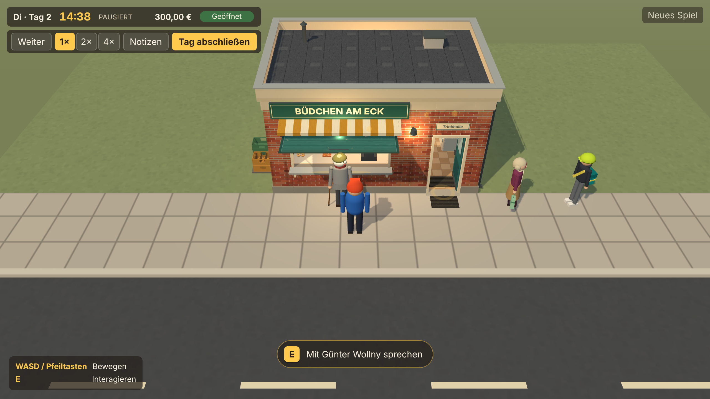
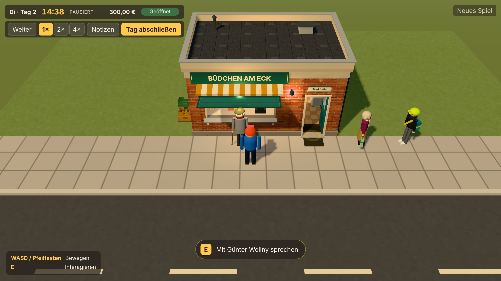
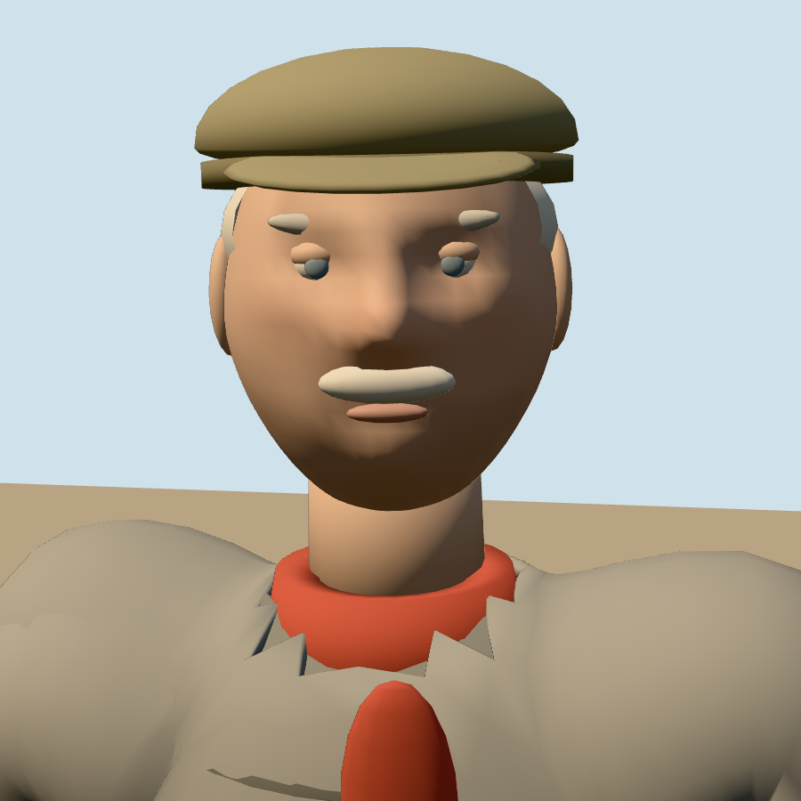

# Visuelle Basis und Style-Spezifikation

**Stand:** 2026-11-14 · [Auftrag 04.5](auftraege/04-5-visual-identity-und-graphics-foundation.md) · Grundlage: [Art Direction](artwork-prompts/01-art-direction.md), [Three.js-Asset-Standard](artwork-prompts/06-threejs-asset-standard.md)

Dieses Dokument hält zwei Dinge fest. Erstens den gemessenen Ausgangszustand der Grafik (Abschnitt 1–3). Zweitens die verbindlichen visuellen Regeln, nach denen ab Phase 5 neue Grafik entsteht (Abschnitt 4–5). Alle Werte sind in der laufenden Anwendung geprüft, aber **nur in Headless-Chromium mit Software-Rendering (SwiftShader)**. Echte Grafikhardware stand nicht zur Verfügung; eine Prüfung dort ist offen.

## 1. Messmethode und Referenzansichten

Werkzeug: `node scripts/visual-shots.mjs --out <Ordner>`. Es startet die Anwendung, setzt über den Debug-Zugang einen festen Spielstand (Tag, Uhrzeit, angehaltene Uhr, Klappe/Tür, Warenbestand über die echte Einräumregel, Bewohner an festen Plätzen, Story-Flags) und eine feste Spielerposition. Die Kamera ist die normale Spielkamera.

| Ansicht | Spielzustand | Spielerposition |
|---|---|---|
| `aussen` | Di, Tag 2, 14:38; 203 Wareneinheiten; Günter am Fenster, Marlene und Jonas am Eck | Gehweg vor dem Fenster (−0,6 / 3,6) |
| `innen` | wie oben, alle 67 Warenplätze bis zur Kapazität gefüllt (1.573 Einheiten) | Gang im Kiosk (0,6 / −0,3) |
| `regale` | wie `innen` | vor dem Mittelregal (−1,6 / −0,7) |
| `bewohner` | Do, Tag 4, 16:50; Flag `yard.bench`; Günter, Marlene und Derya an der Hofbank, Jonas auf dem Gehweg | Gehweg westlich (−3,0 / 3,4) |
| `detail` | wie `aussen`, ohne Bewohner | wie `aussen`; Ausschnitt der Fassade |

Gemessen wird bei 1280 × 720 und Gerätefaktor 1: `renderer.info` (Draw Calls einschließlich Schattenpass, gezeichnete Dreiecke, Geometrien, Texturen), gezeichnete Wareneinheiten, sichtbare Bewohner und die Bildzeit über 4 s bei angehaltenem Spiel. Screenshots entstehen bei Gerätefaktor 2.

**Grenze der Messung:** Software-Rendering schafft hier nur 2–4 Bilder je Sekunde; in 4 s entstehen 8–20 Bilder, die Streuung ist groß. Bildzeiten sind deshalb nur grob und nur untereinander vergleichbar. Für Aussagen über echte Hardware taugen sie nicht. Belastbar sind Draw Calls und Dreiecke.

## 2. Ist-Zustand vor Auftrag 04.5 (Code)

| Bereich | Befund | Codepfad |
|---|---|---|
| Renderer | `WebGLRenderer`, Antialiasing, Pixelverhältnis höchstens 2, Ausgabe sRGB, **kein Tone Mapping**, PCF-Schatten | `src/world/renderer.ts` |
| Kamera | Perspektive, 42° vertikales Sichtfeld, fester Versatz (0 / 9 / 10) zum Spieler, Blickpunkt 1,2 m hoch; Abstand ca. 13,5 m, Neigung ca. 42°; weicher Nachlauf | `src/world/camera.ts` |
| Licht | Halbkugellicht 1,15, Umgebungslicht 0,15, eine Sonne 2,5 (warm) mit Schatten (2048², Ausschnitt ±18 m), drei Punktlichter am Kiosk ohne Schatten (innen 14, Tür 1,6, Markise 4,2) | `src/world/world.ts`, `src/world/assets/kiosk/lighting.ts` |
| Nebel/Himmel | einfarbiger Hintergrund, linearer Nebel 20–62 m | `src/world/world.ts` |
| Materialien | fast ausschließlich `MeshLambertMaterial` mit Palettenfarben; Canvas-Texturen für Klinker, Putz, Boden, Markise, Schild, Etiketten; Glas als durchsichtiges Lambert | `src/world/materials.ts`, `assets/kiosk/materials.ts`, `assets/furniture/materials.ts`, `assets/products/materials.ts` |
| Geometrie | prozedural; Kiosk und Möbel aus zusammengeführten Kästen; Waren als `InstancedMesh` je Produktteil; Bewohner aus geteilten Einheitsformen | `src/world/assets/**`, `src/world/views/stockView.ts`, `src/world/assets/residents/kit.ts` |
| Registry/Platzierung | Asset-IDs → Fabriken; Platzierungen aus den Layoutdaten; flaggebundene Platzierungen | `src/world/assets/registry.ts`, `src/content/regions/ruhrgebiet/layout.ts`, `src/world/placementGates.ts` |

**Messwerte vorher** (`docs/screenshots/auftrag-04-5/vorher/metrics.json`):

| Ansicht | Waren | Draw Calls | Dreiecke | Geometrien | Texturen | Bewohner | Bildzeit Median (Software) |
|---|---|---|---|---|---|---|---|
| aussen | 203 | 485 | 106.008 | 170 | 20 | 3 | 251 ms |
| innen | 1.573 | 272 | 440.088 | 205 | 40 | 0 | 252 ms |
| regale | 1.573 | 272 | 440.088 | 205 | 40 | 0 | 539 ms |
| bewohner | 203 | 559 | 110.124 | 210 | 40 | 4 | 558 ms |
| detail | 203 | 303 | 93.116 | 210 | 40 | 0 | 261 ms |

## 3. Probleme nach Wirkung und Priorität

| Priorität | Problem | Wirkung | Maßnahme in 04.5 |
|---|---|---|---|
| hoch | Waren zu fein unterteilt: Backware 780, Stieleis 636, Tüte 624, PET-Flasche 476, Glasflasche 448 Dreiecke je Stück. Das war die Ursache der Warnung „452.000 Dreiecke bei 1.513 Einheiten“ (gemessen jetzt 440.088 bei 1.573) | volle Regale kosten ein Vielfaches dessen, was bei 4–10 px Bildgröße sichtbar ist | Unterteilung gesenkt (Abschnitt 6) |
| hoch | Flaches Licht: starkes Halbkugel- und Umgebungslicht, schwache Sonne, kein Tone Mapping | Formen lesen sich schlecht, Szene wirkt grau und blass, Lampenspots clippen | Licht neu gewichtet, Neutral-Tone-Mapping |
| mittel | Bewohner aus rund 30 Einzelteilen je Figur | drei Bewohner kosten rund 180 Draw Calls (mit Schattenpass) | statische Teile je Gelenkgruppe und Material zusammengeführt |
| mittel | Wiese matt-oliv, Asphalt sehr dunkel nach Tone Mapping | Außenbereich wirkt trüb | Palette nachgezogen |
| mittel | Etiketten auf Flaschen und Dosen aus der Spielkamera nicht lesbar | Produkte nur über Farbe unterscheidbar | bleibt; Grenzen in Abschnitt 7 dokumentiert |
| niedrig | Horizont: Wiese läuft im Nebel gegen einen einfarbigen Hintergrund | aus der Spielkamera kaum sichtbar | bleibt (Umgebung ist Phase 6) |
| niedrig | Lambert ohne Glanz: Metall, Glas und Kunststoff unterscheiden sich nur über Farbe | Materialcharakter begrenzt | bleibt; Regel für neue Assets in Abschnitt 5 |

## 4. Style-Spezifikation (verbindlich ab Phase 5)

### 4.1 Zielgefühl
Ein liebevoll gebautes, leicht stilisiertes 3D-Diorama eines Ruhrgebietsviertels. Der Kiosk ist der visuelle Anker und darf charaktervoller sein als die Umgebung. Lesbarkeit aus der Spielkamera (Abstand ca. 13,5 m, Neigung ca. 42°, 1280 × 720) geht vor Details, die nur aus der Nähe sichtbar wären.

### 4.2 Farbpalette mit Rollen
Werte aus `src/world/materials.ts` (`palette`) und den Asset-Materialien; sie gelten mit dem Neutral-Tone-Mapping bei Belichtung 1,0.

| Rolle | Farben | Regel |
|---|---|---|
| Grundmaterial Gebäude | Klinker `#b5694c`, Klinker dunkel `#8e4f3a`, Putz `#e7d6b8`, Dachbahn `#474b52` | warm, mittlere Helligkeit; nie reines Weiß oder Schwarz |
| Grundmaterial Umgebung | Gehwegplatten `#bdb8ae`, Bordstein `#d2cec4`, Asphalt `#585b60`, Wiese `#7d935f`, Grund `#78895d` | gedämpft; Umgebung bleibt ruhiger als Kiosk und Waren |
| Holz/Möbel | `#8a6240`, `#b98f5f`, Theke `#e6e0d2`/`#7b8a8f` | warme Mitteltöne |
| Akzent Kiosk | Schildgrün `#25483f`, Tür/Klappe Petrol `#2f6a6e`/`#3f7d73`, Markise Ocker/Creme | gesättigte Akzente nur an Schild, Markise, Tür |
| Waren | Etikettfarben der fiktiven Marken (`docs/PRODUKTKATALOG.md`) | dürfen die kräftigsten Farben der Szene sein; keine realen Marken-Farbwelten |
| UI und Interaktion | Markierung `#ffc94d`, Spielerfigur blau/rot | Gelb ist für Interaktion reserviert; kein anderes Asset nutzt dieses Gelb großflächig |
| Licht | Sonne `#ffe2b4`, Himmel `#dcebf5`, Boden `#8c7f68`, Innenlampe `#ffc27a` | außen warm-neutral, innen deutlich wärmer |

### 4.3 Materialcharakter
- Grundmodell bleibt `MeshLambertMaterial` (matt, günstig). Glanz wird nicht über Spiegelungen erzeugt, sondern über Helligkeit, Kanten und Textur.
- Unterscheidbarkeit der Materialien entsteht über Farbe plus Struktur: Klinker mit Fugen, Putz mit leichter Wolke, Beton mit Plattenfugen, Asphalt mit Körnung, Metall hellgrau und glatt, Kunststoff kräftig farbig und glatt, Glas durchsichtig mit leichter Tönung, Holz warm mit Maserungsandeutung.
- Gebrauchsspuren nur dezent: Tonwertschwankungen, dunklere Sockel und Kanten. Keine starke künstliche Verschmutzung.
- `MeshStandardMaterial` nur, wenn Glanz für die Lesbarkeit wirklich nötig ist (etwa später nasser Boden in Phase 5), und dann mit Vorher/Nachher-Vergleich.

### 4.4 Detaildichte je Sichtabstand
| Größe auf dem Bildschirm (1280 × 720) | Erlaubt | Beispiel |
|---|---|---|
| unter 10 px | Silhouette und ein Farbblock; Rundkörper mit 8 Segmenten | Flasche, Dose, Riegel |
| 10–30 px | Silhouette, zwei Farbflächen, ein großes Emblem; Unterteilung nur, wo sie die Silhouette formt (Tüte 4 × 6) | Tüte, Heft, Backware |
| 30–150 px | Formdetails wie Mütze, Tasche, Werkzeuggürtel; Gesicht nur angedeutet | Bewohner |
| über 150 px | Texturdetails, Beschriftung, Fugen | Fassade, Schild, Markise, Boden |

Richtwerte für neue Assets: Ware höchstens 300 Dreiecke je Stück; Bewohner höchstens 2.500 Dreiecke und 24 Teile nach dem Zusammenführen; Möbelstück höchstens 2.000 Dreiecke. Wiederholte Objekte immer als `InstancedMesh` oder geteilte Geometrie.

### 4.5 Silhouetten und Proportionen
- Leicht überzeichnete, klare Formen: Köpfe und Hände etwas größer, Accessoires deutlich (Mütze, Helm, Tasche), damit eine Figur bei 120 px Höhe erkennbar bleibt.
- Jede Figur unterscheidet sich in Körperform, Kleidungssilhouette und Grundfarbe; zwei Figuren teilen höchstens neutrale Farben.
- Gebäudeteile bekommen sichtbare Kanten und Vorsprünge (Sockel, Putzband, Attika, Fensterbank); flache Wände ohne Kante vermeiden.
- Keine kindliche Comicoptik (keine übergroßen Augen, keine Knubbelproportionen), kein Fotorealismus.

### 4.6 Licht und Schatten
- Außen: eine warme Sonne (3,3) als Hauptlicht mit Schatten, Halbkugellicht (0,85) als Füllung, kaum Umgebungslicht (0,06). Schatten weich (Radius 2,5), Schattenausschnitt ±18 m um den Ursprung.
- Tone Mapping: Khronos PBR Neutral, Belichtung 1,0 (`src/world/renderer.ts`). Es erhält die Farbtöne der fiktiven Marken und rollt Lichtspitzen ab, statt sie abzuschneiden.
- Innen: eine warme Punktleuchte (11) ohne Schatten; Lampen- und Leuchtstreifen sind sichtbar warm. Innen soll wärmer und etwas heller wirken als der Gehweg.
- Schatten werfen: Gebäude, Möbel, Figuren. Keine Schatten: Waren (zu klein, zu teuer), Markierungen, Etiketten.
- Alle Lichtwerte liegen an einer Stelle (`LIGHT` in `src/world/world.ts`, Innenlicht in `assets/kiosk/lighting.ts`).

### 4.7 Fiktive Beschilderung und Waren
- Nur erfundene Namen, Embleme und Farbwelten; nichts, was an reale Marken, Logos, Packungen, Vereine oder Werbekampagnen erinnert.
- Schilder: kräftige Grundfarbe, kontrastreiche Schrift in einfacher Groteskschrift, wenige Wörter. Kleine Schilder dürfen aus der Spielkamera unleserlich sein, wenn ihre Form und Farbe die Funktion zeigen.
- Waren: Form (Verpackungsart) + Farbblock + Emblem der Markenfamilie wirken zusammen. Produktnamen dürfen nicht allein von kleiner Schrift abhängen. Bier und Tabak sachlich ohne Emblem.

### 4.8 Erwünscht und unerwünscht
| Erwünscht | Unerwünscht |
|---|---|
| warme Fassade mit Fugen und Putzband, klare Schattenkante unter Markise und Dach | glatte einfarbige Flächen ohne Kante |
| Waren als Farbblöcke mit Emblem, ordentlich in Reihen | Mikrotext als einziges Unterscheidungsmerkmal; überlappende Waren |
| Figuren mit eindeutigem Accessoire | farbige Kapseln, detailreiche Gesichter |
| gedämpfte Umgebung, kräftiger Kiosk | gleich laute Farben überall, Neonfarben in der Umgebung |
| weiche, gerichtete Sonnenschatten | weißes Füll-Licht, das alle Schatten auflöst |
| Gelb nur für Interaktion | gelbe Großflächen an Assets |

## 5. Regeln für neue Assets
1. Vor dem Bau: Größe auf dem Bildschirm aus der Spielkamera abschätzen und die Detaildichte aus Abschnitt 4.4 wählen.
2. Farben aus der Palette (Abschnitt 4.2) oder begründet ergänzen und dort eintragen.
3. Geteilte Materialien über die vorhandenen Material-Caches verwenden; keine Materialvariante je Objekt.
4. Wiederholte Objekte instanzieren oder zusammenführen; Draw Calls und Dreiecke mit `scripts/visual-shots.mjs` vorher/nachher messen.
5. In der laufenden Szene prüfen (Screenshot aus der Spielkamera), nicht nur in einer Nahaufnahme.

## 6. Umgesetzte Änderungen und Messwerte nachher

Änderungen siehe [Abschlussbericht](PHASE-04-5-ABSCHLUSSBERICHT.md). **Messwerte nachher** (`docs/screenshots/auftrag-04-5/nachher/metrics.json`):

| Ansicht | Waren | Draw Calls | Dreiecke | Geometrien | Texturen | Bewohner | Bildzeit Median (Software) |
|---|---|---|---|---|---|---|---|
| aussen | 203 | 407 (−16 %) | 74.268 (−30 %) | 197 | 20 | 3 | 274 ms |
| innen | 1.573 | 272 | 187.748 (−57 %) | 232 | 40 | 0 | 244 ms |
| regale | 1.573 | 272 | 187.748 (−57 %) | 232 | 40 | 0 | 352 ms |
| bewohner | 203 | 461 (−18 %) | 78.384 (−29 %) | 245 | 40 | 4 | 354 ms |
| detail | 203 | 303 | 61.376 (−34 %) | 245 | 40 | 0 | 241 ms |

Die Bildzeiten streuen im Software-Rendering zu stark für eine Aussage; die Zahl der Geometrien steigt leicht, weil jede Figur ihre zusammengeführten Teile als eigene Geometrie besitzt.

## 7. Warenlesbarkeit aus der Spielkamera (1280 × 720)

| Ware | Unterscheidbar als Kategorie | Unterscheidbar als einzelnes Produkt | Grenze |
|---|---|---|---|
| Hefte (3) | ja | ja (Emblem und Farbe) | Titel nur bei doppelter Pixeldichte lesbar |
| Tüten (Chips, Nüsse, Salzstangen, Fruchtgummi, Drehtabak) | ja | meist (Farbrahmen + Emblem) | Wörter erst bei doppelter Pixeldichte |
| Schachteln, Riegel | ja | meist | sehr kleine Schachteln nur als Farbe |
| Eis (Truhe) | ja | teilweise (Farbe) | Blick in die Truhe flach |
| Backwaren (Theke) | ja | ja (Form und Farbe) | – |
| Flaschen, Dosen (Regal, Kühlschrank) | ja | nur über Farbe und Deckel | 4–6 px breit; Schrift physikalisch nicht lesbar |

Eine dezente Hervorhebung ausgewählter Waren gibt es noch nicht; sie gehört zu einer späteren Interaktion mit einzelnen Waren.

## 8. Figuren-Pipeline und Prototyp Günter (N-002)

Auftrag 04.5, Abschnitt 6A verlangt einen hochwertigen Figuren-Prototyp und eine belastbare Pipeline. Umgesetzt ist **ein Prototyp mit Pipeline**; den geforderten hohen Qualitätsstandard erreicht er **noch nicht** (Bewertung in 8.4).

### 8.1 Weg: Blender-Skript → GLB
- **Quelle ist Code, nicht eine Modelldatei:** `tools/characters/build_resident.py` baut die Figur reproduzierbar in Blender (Python-Modul `bpy` 5.3, ohne Oberfläche) und exportiert GLB. Aufruf:
  `python tools/characters/build_resident.py --resident guenter --out public/models/residents/n-002.glb`
  (Python 3.13 mit `pip install bpy==5.3.0`; Blender selbst wird nicht benötigt). Gleiche Eingabe ergibt dieselbe Datei; Änderungen sind im Diff des Skripts nachvollziehbar.
- **Aufbau:** Körper aus Skin-Modifikator mit Unterteilung (Gelenkpunkte und Radien je Figur), Jacke als aufgedickte Hülle über dem Körper mit Schnitten an Saum und Ärmeln, Kragen, Knöpfen, Taschenklappen; Kopf aus einer verformten Kugel (Stirnwulst, Augenhöhlen, Nase, Wangen, Kiefer, Kinn) mit Augen, Lidern, Brauen, Ohren, Lippe, Schnurrbart, Haarkranz und Schiebermütze; Schal und Stock als Requisiten. Farben je Zone als eigene Materialien.
- **Rig:** 17 Knochen (Becken, Wirbelsäule, Brust, Hals, Kopf, Ober-/Unterarm, Hand, Ober-/Unterschenkel, Fuß je Seite). Körper und Jacke automatisch gewichtet, starre Teile (Kopfteile, Schal, Stock) mit vollem Gewicht auf ihren Knochen.
- **Animation:** drei Clips, als Schlüsselbilder aus Formeln erzeugt: `idle` (8 s, Atmen, Gewichtsverlagerung, Kopfbewegung), `walk` (1 s, ein Doppelschritt mit kurzem Schritt und leicht vorgebeugtem Oberkörper), `talk` (3 s, Kopfnicken, Handgeste).
- **Werkzeug zur Sichtprüfung:** `tools/character-viewer/` (Vite-Seite `/tools/character-viewer/index.html?view=close|game|side|back&clip=idle|walk|talk&time=…&face=1`) zeigt die GLB mit Renderer und Licht des Spiels.

### 8.2 Vertrag einer Figurendatei
| Punkt | Festlegung |
|---|---|
| Format, Ort | GLB unter `public/models/residents/<asset-id>.glb`, eingetragen in `RESIDENT_MODELS` (`src/world/assets/residents/glbResident.ts`) |
| Maßstab, Pivot, Richtung | 1 Einheit = 1 m, Pivot zwischen den Füßen auf dem Boden, Blick nach +Z (wie die prozeduralen Figuren) |
| Clips | `idle`, `walk` (ein Schrittzyklus bei `walkSpeed` m/s), `talk`; fehlende Clips werden übersprungen |
| Skelett | ein Skin; jede Instanz erhält eine eigene Kopie (`SkeletonUtils.clone`), Geometrien und Materialien werden geteilt |
| Materialien | glTF-PBR (`MeshStandardMaterial`), nicht metallisch, Rauheit 0,3 (Augen) bis 0,95 (Mütze), keine Texturen; Farben je Zone als eigenes Material |
| Budget je Figur | ≤ 25.000 Dreiecke, ≤ 20 Primitive (Draw Calls je Pass), ≤ 1 MB Datei |
| Laufzeit | `residentView` lädt die Datei beim Start; bis dahin und bei Ladefehler (Warnung im Log) bleibt die prozedurale Figur. In Node (Tests) wird nie geladen |
| Gewichtung der Clips | Gehen folgt der Geschwindigkeit (Wiedergabetempo `speed / walkSpeed`, 0,5–1,6), Sprechen überlagert, Idle füllt den Rest; weiche Übergänge |

### 8.3 Messwerte
| Wert | Prozedural (Auftrag 04.5 zusammengeführt) | GLB-Prototyp |
|---|---|---|
| Dreiecke | rund 2.000 | 21.072 |
| Vertices | – | 10.873 (Position, Normale, 4 Gelenke, 4 Gewichte) |
| Primitive / Materialien | 8–12 Meshes | 19 Primitive, 16 Materialien |
| Datei | – | 753 kB (Geometrie und Animation 695 kB) |
| GPU-Speicher (geschätzt) | – | rund 0,5 MB Geometrie, einmal geteilt; je Instanz nur Skelett (17 Matrizen) |
| Szene `aussen` (3 Bewohner) | 407 Draw Calls, 74.268 Dreiecke | 409 Draw Calls, 112.120 Dreiecke |
| Szene `bewohner` (4 Bewohner) | 461 Draw Calls, 78.384 Dreiecke | 463 Draw Calls, 116.236 Dreiecke |

Die Dreiecke steigen um rund 38.000 (Figur plus Schattenpass); die Draw Calls bleiben praktisch gleich. Für vier GLB-Figuren wären rund 170.000 Dreiecke zu erwarten, weniger als volle Regale. Bildraten auf echter Hardware sind nicht gemessen. Ein LOD ist bei vier Figuren nicht nötig; ab etwa zehn gleichzeitig sichtbaren Figuren sollte das Skript eine zweite, gröbere Stufe (Unterteilung 1 statt 2) exportieren.

### 8.4 Ehrliche Bewertung gegen die Abnahme (6A)
| Kriterium | Stand |
|---|---|
| Nahansicht: überzeugende Gesichts- und Kleidungsdetails | **teilweise.** Älterer Mann mit Mütze, Schnurrbart, Lidern, Ohren, Schal klar lesbar; Gesicht wirkt aber glatt und puppenhaft, Brauen und Schnurrbart als einfache Wülste, keine Hautstruktur, keine Falten im Gesicht. Jacke mit Saum, Kragen, Knöpfen, Taschen, aber ohne echten Faltenwurf und Nähte |
| Spielkamera: Proportionen und Silhouette | **ja.** Gebeugte Haltung, Stock, Mütze und graue Jacke unterscheiden Günter klar; Proportionen erwachsen statt Blockfigur |
| Geh- und Idle-Animation natürlich, ohne Deformation | **teilweise.** Gehen und Idle laufen flüssig; beim Sprechen dringt der Körper am rechten Oberarm durch den Ärmel, die Hände sind Fäustlinge ohne Finger, der Stock steht im Idle zu weit vom Körper ab |
| Passt zu Licht und Materialwelt | **teilweise.** Schatten und Licht stimmen; die PBR-Materialien wirken heller und weicher als die matten Lambert-Materialien der anderen Figuren |
| Identität stabil über Blickwinkel | **ja** (vorne, seitlich, hinten, Spielkamera) |
| Performance und Speicher dokumentiert | **ja** (8.3) |

**Qualitätslücke:** Ein Skript aus Grundformen erreicht nicht die Qualität eines von Hand modellierten, gesculpteten und texturierten Charakters. Für den in 6A beschriebenen Standard fehlen: Hände mit Fingern, ein gesculptetes Gesicht mit Alterszügen (Falten, Tränensäcke, Nasolabialfalten), Haar- und Stoffstruktur über Texturen oder Normal Maps, echter Faltenwurf, eine saubere Topologie an Schultern und Ellbogen sowie Gesichtsausdrücke (Blend Shapes). Die Pipeline (GLB-Vertrag, Laden, Skelettkopie, Clip-Gewichtung, Fallback, Messung) trägt solche Modelle bereits: Ein von Hand erstelltes GLB nach Vertrag 8.2 ersetzt die Skriptfigur ohne Codeänderung.

**Empfehlung vor den übrigen Bewohnern:** den Prototyp abnehmen oder nachschärfen lassen. Zwei Wege: (a) das Skript gezielt verbessern (Finger, Ärmeltopologie, Brauen, Texturen) – günstig, Obergrenze sichtbar; (b) eine von Hand modellierte Figur nach dem Vertrag (Künstler oder Auftragsarbeit), die das Skript als Maß- und Proportionsvorlage nutzt – höchste Qualität. Erst danach N-003, N-006, N-007 umstellen.

